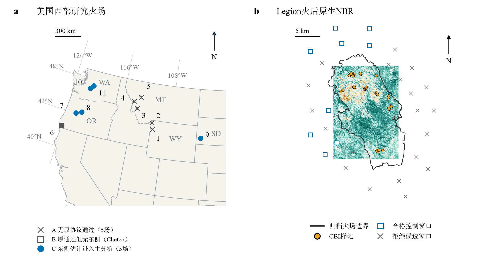
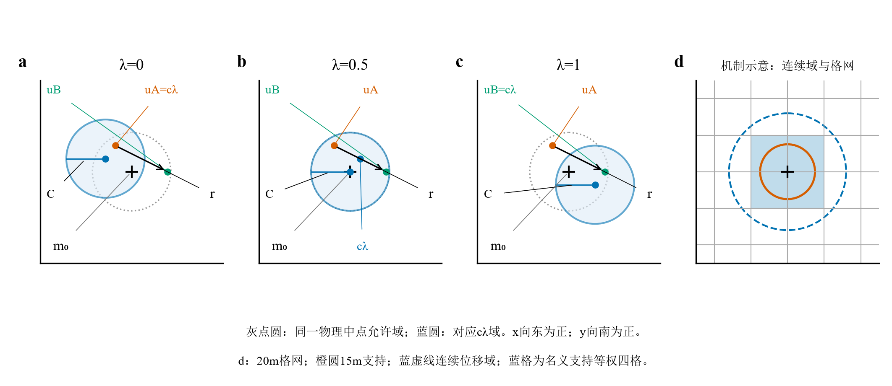
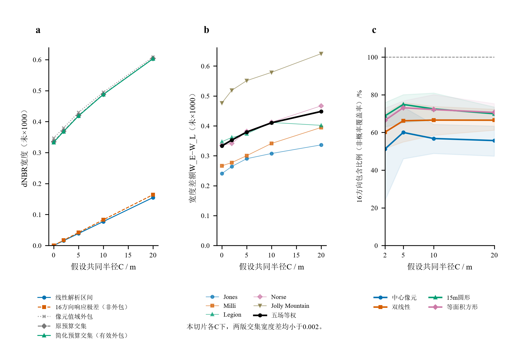
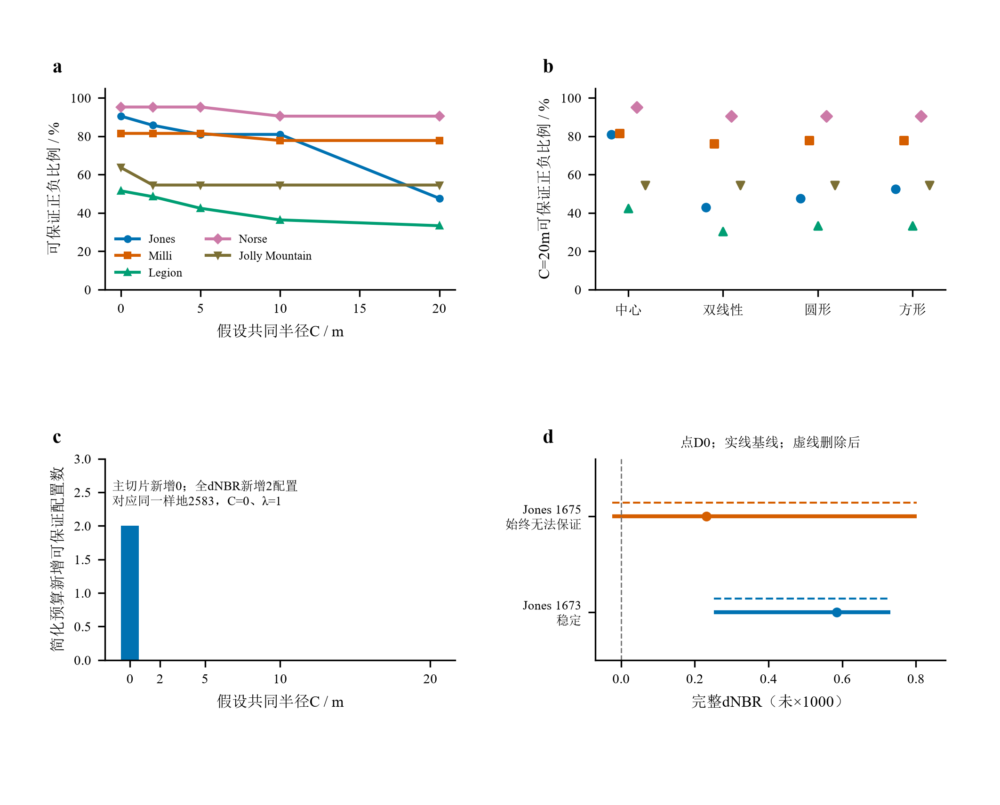

# 稀疏相对配准控制下火烧指数响应边界与判别能力

**本科科研项目 · 尚未经过同行评审 · 投稿候选稿待作者核定**

相对配准告诉我们两期影像“相差多少”，却不能单独确定它们共同偏移了多少。本项目考察：在明确声明位置允许域之后，哪些火烧指数判断仍有确定性保证？

本仓库是研究展示与部分复现材料。研究价值在于连接 **相对控制 → 原生像元支持 → 响应外包 → 零阈值判别**，并区分边界收窄、响应敏感性与实际判别收益。

## 科学问题与研究思路

影像错配与空间异质性会共同影响变化测量。我们使用冻结的 Sentinel-2 原生20米 NBR窗口，把两期位移写成相对位移和共同位移，再对中心像元、双线性、15米圆形、等面积方形四种支持计算条件响应边界。详见[研究问题](研究概览/研究问题.md)与[方法概览](研究概览/方法概览.md)。

研究背景为11个美国西部火场、264条记录；主分析限定在有东侧合格相对估计的5场、140条记录和27个控制估计。另保留109条严格质量子集作稳健性分层。上游外业与火场资料来自 [Rodman等公开归档的固定版本](https://zenodo.org/records/21986637)。

## 主要结果

下表限定于 **15米圆形支持、dNBR、对称分配 λ=0.5**。指数未乘1000。

| 共同位移假设半径 C | 主分析保证正负记录 | 五场等权保证比例 | 严格质量子集保证记录 | 严格子集五场等权比例 |
| --- | --- | --- | --- | --- |
| 0米 | 107 / 140 | 76.47% | 78 / 109 | 71.64% |
| 2米 | 104 / 140 | 73.09% | 75 / 109 | 68.20% |
| 5米 | 101 / 140 | 70.93% | 73 / 109 | 66.58% |
| 10米 | 96 / 140 | 68.02% | 69 / 109 | 64.32% |
| 20米 | 88 / 140 | 60.75% | 61 / 109 | 56.98% |

- 相对配准约束两期位移之差，不能识别共同位移；C是声明的允许域半径，不能解释成GPS置信半径。
- 有限方向计算是诊断，不能证明整个连续允许域已被响应区间包含。包含比例也不是概率。
- 在完整可达支持、非负归一化权重和有效分母等条件下，像元值域可形成确定性外包；主切片边界仍较宽，部分记录仍可保证符号。
- C从0增至20米时，所列主切片保证比例下降。该趋势有明确情景条件，不是任意影像与支持的普遍定律。
- 预算简化在主切片全部C下新增保证判断均为0；全部dNBR情景仅新增同一样地的2个配置。严格收窄配置比例17.52%与19.79%不能写成性能或精度提升。
- 27次控制删除、严格质量子集及空间留出检验稳定性；控制删除可明显改变端点，主切片符号判断仍保持。结果是条件性的，不提供普适精度提升规则。

详见[主要发现](研究概览/主要发现.md)与[关键结果表](关键结果/关键结果摘要.csv)。28000个基线配置和119400个删除配置均为重复条件计算，不能视为同等数量独立样本。

## 核心图件

### 研究范围与证据层级



区分全部火场、匹配通过窗口与主分析东侧控制。三级数量不能合并为同一配准精度样本。底图与数据来源见[数据说明](数据说明/数据来源.md)。

### 共同位移的几何机制



同一物理域可以有不同参数表示；改变分配参数时必须同时检查允许域圆心。相对结果不构成绝对定位真值。

### 有效外包宽度



像元值域在所列切片主导多数端点。有限方向包含诊断不能替代连续域保证，C=0的退化点另作残差解释。

### 从响应区间到判断



判断取决于完整指数区间的位置和宽度。无法保证同号不等于已发生翻转；零阈值符号也不等于生态烈度等级。

[全部八幅正式图件](正式图件)还包括原生格网、算法差与合成恢复、控制删除传播以及条件迁移反例。

## 研究边界

独立地理对象只有五个主分析火场；外围控制不能充分识别内部空间位移。严格筛选会改变火场内记录组成，比例差不能解释为精度差。我们区分已能保证、无法保证与已找到数值翻转三类证据；详见[研究边界与局限](研究概览/研究边界与局限.md)。

## 数据可用性

本仓库提供分析代码、关键统计结果、图件及数据获取说明。由于上游数据的体量、来源许可或再分发限制，原始数据未随仓库直接提供。

公开材料不含原始CBI数据、Sentinel-2影像、大型栅格或完整数据缓存。上游省略的外业资料与部分位置不能由本项目补供。见[数据来源](数据说明/数据来源.md)、[获取说明](数据说明/数据获取说明.md)及[许可与再分发限制](数据说明/数据许可与再分发限制.md)。

## 代码与复现

```console
python 代码/统计复核/复核关键结果.py
```

上述入口使用仓库内汇总表，重建主切片记录数量、五场等权比例，并检查冻结图表文件摘要。它不重算原生质量规则或全部科学实验。

[原生响应计算核心](代码/主分析/响应边界.py)保留封版数学函数；[可移植运行入口](代码/主分析/运行分析.py)接受用户自行准备的原生NBR窗口。未提供这些输入，因此不能克隆后立即复现全部结果。见[运行说明](代码/运行说明.md)、[环境与依赖](复现说明/环境与依赖.md)、[主要结果复现](复现说明/主要结果复现.md)、[结果对应关系](复现说明/结果对应关系.md)。

## 项目状态、引用与权利

Manuscript: in preparation / under author review. 当前研究尚未经过同行评审，不代表期刊已接受。仓库基于R6.3最终技术封版，只发布展示与部分复现所需内容；全文及完整补充材料暂不公开。

License information will be added after author verification. 未为本项目新代码或图件擅自指定开源许可证。上游许可不自动覆盖本项目新增成果。研究结果仍属于作者研究成果。

项目引用暂使用仓库地址、项目标题及访问日期；作者、期刊与新增成果DOI尚未核定，不编造正式出版引用。方法与数据引用见[参考文献](引用与版本/参考文献.md)；整理范围见[版本说明](引用与版本/版本说明.md)。
